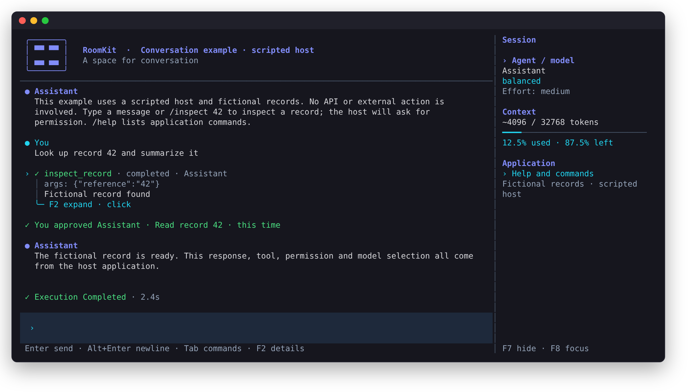

# RoomKit TUI

**An embeddable terminal interface for AI conversations, written in Rust.**

[](https://github.com/roomkit-live/roomkit-tui/actions/workflows/ci.yml)
[](LICENSE)
[](Cargo.toml)

<p align="center">
  
</p>

RoomKit TUI gives your application a complete terminal chat interface, while
your application keeps control: it chooses the agents, models, tools,
commands, history and policies, and the terminal displays their state and
collects the user's input. It is built for
[RoomKit](https://www.roomkit.live) and ships an adapter for the
[RoomKit Rust engine](https://github.com/roomkit-live/roomkit-rs), but the
terminal itself is engine-agnostic: any host that speaks its typed protocol can
drive it.

> [!NOTE]
> **Early development (0.2).** The library crates are on crates.io, except the
> RoomKit adapter, which is taken through Git. Their APIs will change before
> 1.0. Feedback and contributions are welcome.

## Features

- **Streaming conversations**: incremental model output rendered as
  CommonMark/GFM, with tables, task lists and syntax-highlighted code.
- **Tool calls**: live state for each call, structured results, custom
  per-tool renderers and an optional compact activity view.
- **Human approvals you can trust**: one-time permission cards, shown in full
  or not at all, that accept an answer only once they have been on screen for
  half a second. With the RoomKit adapter, only the person who started a run
  can answer its requests. Host-confirmed receipts stay in the history.
- **Host commands**: slash-command menus with argument completion, choice
  pickers, interaction modes (Shift+Tab), forms with masked secrets and
  live read-only panels.
- **Run control**: elapsed time per run, interruption with Esc, context and
  token usage reported by the host, and an optional host warning about what
  exiting stops.
- **Long sessions stay fast**: each frame lays out only the history it shows,
  and rendered messages and tool results are cached per item.
- **Customizable**: branding, dark, light or terminal-palette themes,
  `NO_COLOR` support, configurable composer, optional sidebar and welcome
  screen.
- **Mouse support**: click to expand tool details, drag to copy through OSC 52,
  or leave selection entirely to the terminal.
- **Clipboard images**: attach PNG images with Ctrl+V when the host accepts them.
- **Terminal integration**: optional [OSC 7501](https://www.superlogical.com/rex/docs/build/program-status)
  program status reporting.
- **Forward-compatible protocol**: refusals carry a stable error code, and an
  older terminal ignores events, items and states a newer host adds.
- **Testable without a terminal**: a pure session projection and a
  deterministic renderer for headless checks.

## Crates

| Crate | Purpose |
| --- | --- |
| [`roomkit-tui-protocol`](crates/roomkit-tui-protocol) | Serializable identities, requests, events, typed refusals and shared limits. No I/O, no async runtime. |
| [`roomkit-tui-transport`](crates/roomkit-tui-transport) | Bounded, ordered in-process queues connecting a terminal to a host; the host side splits into a reader and a publisher. |
| [`roomkit-tui`](crates/roomkit-tui) | The Crossterm terminal: input, menus, approvals, rendering. No engine, provider or domain logic. |
| [`roomkit-tui-engine`](crates/roomkit-tui-engine) | Adapter connecting an application-owned RoomKit engine to the protocol. No terminal dependency. |
| [`roomkit-tui-examples`](examples) | Runnable example applications (not published). |

## Quick start

Install Rust with [rustup](https://rustup.rs). The repository pins its
toolchain in `rust-toolchain.toml`; rustup installs it on first use.

```sh
git clone https://github.com/roomkit-live/roomkit-tui
cd roomkit-tui
cargo run -p roomkit-tui-examples --bin assistant-demo
```

The two scripted examples, `assistant-demo` and `order-support`, simulate
their models and tools with fictional data. They need no credentials and no
network. Send a message, answer the permission request with Ctrl+Y or Ctrl+N,
and watch the tool run and the response stream. Type `/help` to list the
example's commands.

Each example also runs headless, to verify the interaction or inspect the
event stream:

```sh
cargo run -p roomkit-tui-examples --bin order-support -- --check
cargo run -p roomkit-tui-examples --bin order-support -- --json
```

Try the presentation options with the examples' flags (`--help` lists them):

```sh
cargo run -p roomkit-tui-examples --bin order-support -- --theme light
cargo run -p roomkit-tui-examples --bin assistant-demo -- \
  --brand "Research desk" --command-prefix '$' --no-animation --no-color
```

### Connect a real model

`roomkit-chat` runs the real RoomKit engine with an OpenAI-compatible endpoint
and a SQLite store. Its only tool looks up fictional records.

```sh
export ROOMKIT_BASE_URL=http://localhost:8000/v1
export ROOMKIT_MODEL=your-model
export ROOMKIT_API_KEY=...   # only if your endpoint requires one
cargo run -p roomkit-tui-examples --bin roomkit-chat -- \
  --database ./conversation.sqlite3 --room conversation
```

Reuse the same database and room to resume the conversation. The example sends
an API key only over HTTPS or to this machine; `--allow-insecure-http` lifts
that guard. `--check` runs the full path (HTTP streaming, a tool call, a SQLite
restart) against a local fixture instead of a model service.

## How it works

```text
┌────────────────────────────────┐   Request   ┌────────────────────────┐
│ Host (your application)        │ ◄────────── │ roomkit-tui            │
│                                │             │                        │
│ RoomKit + roomkit-tui-engine, │             │ input, menus,          │
│ or your own event loop.        │ ──────────► │ approvals, rendering   │
│ Owns agents, tools, history,   │    Event    │ (Crossterm)            │
│ policies and persistence.      │             │                        │
└────────────────────────────────┘             └────────────────────────┘
        roomkit-tui-transport: bounded, ordered in-process queues
        roomkit-tui-protocol:  typed, serializable requests and events
```

The terminal sends correlated requests (submit a message, invoke a command,
answer a permission, interrupt a run). The host accepts each request, or
refuses it with a `Rejection` carrying a stable `ErrorCode` and a message to
display. It then publishes events: snapshots, streamed text, tool states,
permissions, model and usage updates, run completion. A few rules hold
throughout:

- **The host is the source of truth.** The terminal keeps a bounded
  projection for display, not a second conversation database. Model changes,
  mode changes and permission answers appear only once the host confirms them.
- **Acceptance is not completion.** A reply acknowledges a request; a separate
  event reports that the execution finished.
- **Permissions are one-time and deliberate.** An answer settles one
  outstanding decision and never grants a lasting permission. A request too
  large to show in full is never shown, and a new card ignores keys typed for
  the composer.
- **Detaching is not cancelling.** Closing the terminal disconnects its view;
  the application decides what keeps running and owns cleanup.
- **The terminal executes nothing.** It never runs providers, tools or shell
  commands, and it only offers the commands the host advertises.
- **Output is sanitized and bounded.** Every host, model and tool string is
  stripped of terminal control sequences and bidirectional overrides before it
  is drawn, and the view bounds what it retains from any host.

## Use it in your application

`roomkit-tui`, `roomkit-tui-protocol` and `roomkit-tui-transport` are on
crates.io, for a host that speaks the protocol itself:

```toml
[dependencies]
roomkit-tui = "0.2"
```

`roomkit-tui-engine`, the RoomKit adapter, is not: it depends on the RoomKit
Rust engine by Git. Take it through Git, pinned to a commit, with `roomkit-tui`
from the same commit so that both share the protocol's types:

```toml
[dependencies]
roomkit-tui = { git = "https://github.com/roomkit-live/roomkit-tui", rev = "<commit>" }
roomkit-tui-engine = { git = "https://github.com/roomkit-live/roomkit-tui", rev = "<commit>" }
```

### With the RoomKit engine

Your application builds its RoomKit instance (store, agents, tools, policies),
registers a `ConversationChannel` and attaches it to the room. The adapter then
connects that room to the terminal:

```rust
use std::num::NonZeroUsize;

use roomkit_tui_engine::{LocalSession, SessionConfig};
use roomkit_tui::{UiOptions, connection, render::Renderers};

let config = SessionConfig::new(room_id, agent_id, "local-user");
let (client, host) = connection(NonZeroUsize::new(256).expect("nonzero capacity"));

// The adapter streams engine events to the view and forwards its requests.
let adapter = tokio::spawn(LocalSession::new(kit.clone(), channel.clone(), config).run(host));

// The terminal blocks its thread until the user exits or detaches.
let terminal = tokio::task::spawn_blocking(move || {
    roomkit_tui::run_with_options(client, Renderers::default(), UiOptions::default())
})
.await;

adapter.await??;
channel.idle().await; // Let the current turn settle and store its decisions.
kit.close().await?; // The application owns the engine's shutdown.
terminal??;
```

To show context and token usage, describe the agent's model with the provider
name your engine reports, for example `OpenAIAIProvider` for `roomkit-openai`:
`config.model = Some(ModelInfo::new("OpenAIAIProvider", "gpt-4.1"))`.

[`examples/src/engine/mod.rs`](examples/src/engine/mod.rs) is the complete,
runnable version. The [adapter's README](crates/roomkit-tui-engine/README.md)
covers application commands, long-running host work, interruption, several
views of one room and usage measurements.

### Ask for approval

Tools run in your engine, so your engine decides which calls need a person.
In a `BEFORE_TOOL_USE` hook, ask the attached view and wait for the answer:

```rust
use std::time::Duration;

use roomkit::model::HookResult;
use roomkit::{HookOptions, HookTrigger, ToolCallEvent};
use roomkit_tui_engine::PermissionRequest;
use roomkit_tui::protocol::Decision;

let views = channel.clone();
kit.hook(
    HookTrigger::BeforeToolUse,
    move |event: ToolCallEvent, _context| {
        let views = views.clone();
        async move {
            let request = PermissionRequest::new(
                "Delete the build directory?",
                "rm -rf ./build",
                Duration::from_secs(120),
            )
            .with_summary("Deleted the build directory");
            Ok(match views.ask_tool_permission(&event, request).await {
                Decision::Allow => HookResult::allow(Default::default()),
                _ => HookResult::block("Refused by the user", Default::default()),
            })
        }
    },
    // A person may take longer than a hook's default 30 seconds.
    HookOptions {
        name: "approval".to_owned(),
        timeout: Duration::from_secs(300),
        ..Default::default()
    },
)?;
```

No view, a timeout, an interruption or a refusal all block the call.

### With your own host

Without RoomKit, run your own loop on the `Host` end of the connection: send an
initial `Event::Snapshot`, answer each `Request` with an `Event::Reply`, then
publish the events of the work you perform. Every protocol type has a
constructor:

```rust
use std::time::Duration;

use roomkit_tui::protocol::{Actor, Command, ErrorCode, Event, Rejection, Snapshot};

let mut snapshot = Snapshot::new("support", "Support desk", Actor::new("agent", "Agent"));
snapshot.can_interrupt = true;
host.try_send(Event::Snapshot(snapshot))?;
loop {
    let request = match host.recv_timeout(Duration::from_millis(100)) {
        Ok(request) => request,
        Err(std::sync::mpsc::RecvTimeoutError::Timeout) => continue,
        Err(_) => break, // The terminal detached.
    };
    let error = match &request.command {
        Command::Submit { .. } => None, // Start the work, then publish its events.
        _ => Some(Rejection::new(ErrorCode::Unsupported, "Not available here")),
    };
    host.try_send(Event::Reply { request: request.id, error })?;
}
```

[`examples/src/demo`](examples/src/demo) implements a complete scripted host,
with commands, a permission request, a tool call and streamed text.

### Present your tools

Unknown tools get a generic, JSON-aware presentation. Register a
`ToolRenderer` to format a tool's structured result:

```rust
use roomkit_tui::protocol::ToolCall;
use roomkit_tui::render::{Renderers, ToolRenderer};

struct OrderStatus;

impl ToolRenderer for OrderStatus {
    fn render(&self, call: &ToolCall) -> Vec<String> {
        match call.data.as_ref().and_then(|data| data["status"].as_str()) {
            Some(status) => vec![format!("Order status: {status}")],
            None => vec!["Looking up the order…".into()],
        }
    }
}

let mut renderers = Renderers::default();
renderers.register("order_status", OrderStatus);
```

### Customize the appearance

`UiOptions` holds every presentation choice; the library reads no
configuration file of its own.

```rust
use roomkit_tui::{Branding, SelectionMode, Theme, UiOptions};

let mut options = UiOptions::default();
options.branding = Branding::new("Research desk")
    .with_subtitle("Explore your records")
    .with_logo(vec!["[R]".into()]); // Plain text; no logo hides it.
options.theme = Theme::light(); // Or dark(), terminal(), or your own palette.
options.input_placeholder = "Ask about your records…".into();
options.selection = SelectionMode::CopyOnSelect; // Native leaves the mouse to the terminal.
options.tool_activity = true; // One updating line per sequence of tool calls.
```

The [`roomkit-tui` README](crates/roomkit-tui/README.md) describes each
option and optional feature (sidebar, welcome screen, forms, panels, images,
terminal status, session observation) in detail.

## Keyboard and mouse

| Key | Action |
| --- | --- |
| Enter | Send the message or the command |
| Ctrl+S, Ctrl+Enter | Send the message now: interrupt whatever runs and send it once nothing runs any more |
| Alt+Enter, Ctrl+J, Shift+Enter | Insert a newline (Shift+Enter where the terminal reports it) |
| `/` (configurable) | Open the host's commands; type to filter |
| Tab, Enter in a menu | Insert the highlighted choice; Enter again sends it |
| Esc | Close the current menu or panel, cancel sending a message after the interruption (it stays in the composer), otherwise interrupt the run |
| Ctrl+Y, Ctrl+N | Allow once or deny the pending permission |
| ↑↓ or 1, 2, then Enter | Choose and confirm an answer on the permission card |
| Up, Down | Move between lines, or browse input history |
| Ctrl+P, Ctrl+N | Browse input history |
| PageUp, PageDown | Scroll the conversation, or the pending permission's details |
| Ctrl+End | Return to the latest message |
| F2 | Expand or collapse the focused tool |
| Shift+F2 | Expand or collapse all tools |
| Alt+Up, Alt+Down | Focus the previous or next tool |
| Shift+Tab | Switch to the host's next interaction mode; in a menu, move up |
| Ctrl+V | Paste text, or an image when the host accepts images |
| Alt+Backspace | Remove the last attached image |
| F6 | Invoke the host's background-work command |
| F7, F8 | Show or hide the sidebar; focus it |
| Ctrl+C | Clear the draft and interrupt; press twice to exit |
| Ctrl+D | Detach the terminal; the host keeps running. If the host warns what exiting stops, press twice |

A permission card accepts an answer once it has been on screen for half a
second, so a key meant for the composer never answers it. With the default
mouse mode, click a tool's link to expand it and drag across text to copy it.
To copy more than the screen shows, keep the button held and turn the wheel,
or hold the pointer above or below the conversation: it scrolls and the
selection follows. Text copied from the conversation stays highlighted until
the next click, key, paste or resize.
Pastes keep their newlines and never send by themselves.

## Platform support

Linux and macOS are supported and tested in CI, including a pseudo-terminal
test of the interactive session. Windows is not tested yet. Clipboard copy
relies on OSC 52, which depends on your terminal's support and settings.
Pasting images needs a local desktop session: over SSH, the remote host cannot
read your computer's clipboard.

## Development

The development checks need Python 3.11 or later, and
[`cargo-deny`](https://github.com/EmbarkStudios/cargo-deny) for the audit.

```sh
make check   # formatting, Clippy, tests, docs, examples, terminal smoke tests
make msrv    # tests with the minimum supported Rust version (1.92)
make audit   # licenses, sources and security advisories
```

Generate the API documentation with `cargo doc --workspace --no-deps --open`.

## Stability

The crates follow semantic versioning; before 1.0, a minor release may break
the API, and the changelog says how. Public types are `#[non_exhaustive]`, so
new fields and variants are not breaking: build structs with their
constructors and match enums with a wildcard arm. On the wire, an older
terminal ignores the events, items and states a newer host adds; an unknown
answer to a permission is never read as an approval. The minimum supported
Rust version is 1.92 and is tested in CI.

## Roadmap

- Windows support and testing.
- Configurable keybindings, richer engine controls and model capabilities.
- Automatic reconnection, durable event cursors and a remote transport to a
  RoomKit service.
- Python bindings.

## Contributing

Contributions are welcome: bug reports, documentation, fixes and features.
Read [CONTRIBUTING.md](CONTRIBUTING.md) for the design rules, the checks to run
and the commit conventions. For a large change, open an issue first so we can
agree on the approach. Everyone taking part follows the
[code of conduct](CODE_OF_CONDUCT.md).

## Security

Please do not report security issues in public issues. Use GitHub's
[private vulnerability reporting](https://github.com/roomkit-live/roomkit-tui/security/advisories/new)
instead; see [SECURITY.md](SECURITY.md).

## License

RoomKit TUI is licensed under the [MIT License](LICENSE).
